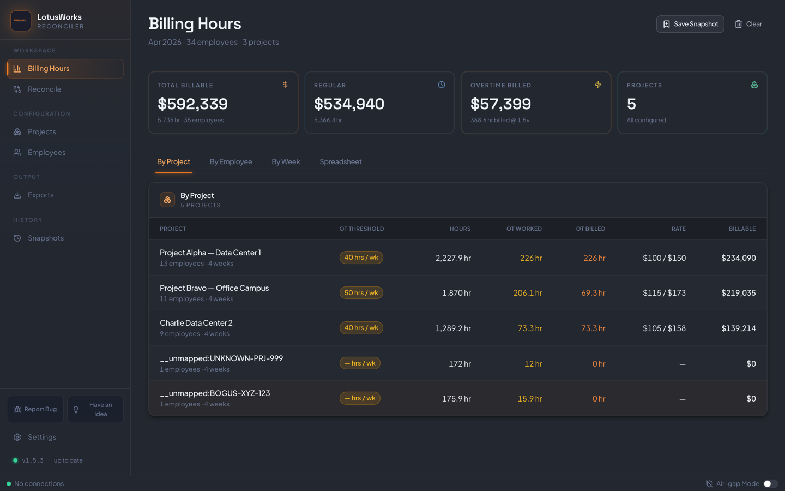

# Finance Reconciliation

A browser app I built for a finance team's monthly billing close. It takes the Paycom monthly hours export (Excel) and the weekly timesheet PDFs for each employee, checks that the two agree, and turns the hours into billable lines per employee, project and week. From there it produces client invoices and a billing workbook.

The payroll export gives one row of monthly hours per employee, with overtime calculated at 40 hours a week. Clients are billed per project and per week, and the overtime threshold is set per project, so a project that only bills overtime past 50 hours needs a different split than the one payroll used. Before this, getting from one to the other meant cross-referencing the Excel summary against a folder of PDFs and rebuilding the split by hand.



The billing data can be viewed by project, by employee, by week, or as one flat virtualized table with a row per employee/project/week. A banner flags it if those views stop adding up to the same total.

## What it does

- Reads the Excel export without a fixed template. It scans the first rows of the sheet, scores each one against known column names (employee code, legal first/last name, regular/OT/DT hours, allocation), and uses the best match as the header row.
- Parses timesheet PDFs with pdf.js text extraction into week / allocation code / hours entries. Each entry keeps a confidence score and the page it came from, so a number can be traced back to the PDF.
- Cross-checks the two sources and flags employees who appear in only one of them, monthly totals that differ by more than 0.1 h (shown as info instead of a warning when fewer than four weeks of PDFs are loaded), and allocation codes that don't map to a project.
- Maps allocation codes to projects by exact alias first, then by code family (all `ABC-*` codes) when only one project claims that family.
- Splits each employee/project/week bucket into regular, OT and double time at that project's thresholds. Rates fall back from a per-project employee override, to the employee's default rate, to the project default, with OT at 1.5x and DT at 2x unless overridden.
- Exports an invoice PDF per client (pdf-lib), an Excel workbook with a summary sheet and one tab per project (ExcelJS), CSV, and a JSON backup. Project and employee rate cards can be imported and exported as CSV.

All data stays in the browser in IndexedDB. Each month can be saved as a named snapshot and reopened from the Snapshots page. The only network call is an update check against this repo's GitHub releases, and an air-gap setting turns that off.

The Reconcile tab, for comparing against a client's own hours log, is a placeholder for now.

## Stack

React 19, TypeScript, Vite, Zustand, TanStack Table and Virtual, Tailwind, SheetJS and ExcelJS, pdf.js, pdf-lib, Zod, idb. Vitest and Playwright for tests.

## Run locally

```bash
npm ci
npm run dev
```

To build the single-file version (everything inlined into one HTML file that opens from disk):

```bash
npm run build       # type-checks, then writes dist/Reconciler-v<version>.html
npm run typecheck   # type-check only
```

There's also a hosted copy at https://noahfgarrett.github.io/FinanceReconciliation/.

## Sample data

No real payroll data is in the repo. To get something to import:

```bash
npx tsx test-data/generate.ts
```

This writes a monthly Excel export, a folder of weekly timesheet PDFs and a client hours log to `test-data/output/` (gitignored). The projects and people in it are made up. The set includes deliberate problems: hour mismatches, employees missing from one source, wrong allocation codes, extra overtime and duplicate weeks. The screenshot above is that data after import.

## Tests

```bash
npm test          # Vitest: parsers, reconciliation, OT and rate logic, persistence
npm run lint      # ESLint with --max-warnings=0
npm run e2e       # Playwright
```

The Playwright suite runs against the hosted copy by default. Set `RECON_BASE_URL` / `RECON_PAGE_URL` to point it at a local server. The full import test only runs when `RECON_XLSX` and `RECON_PDF_DIR` point at real files.
